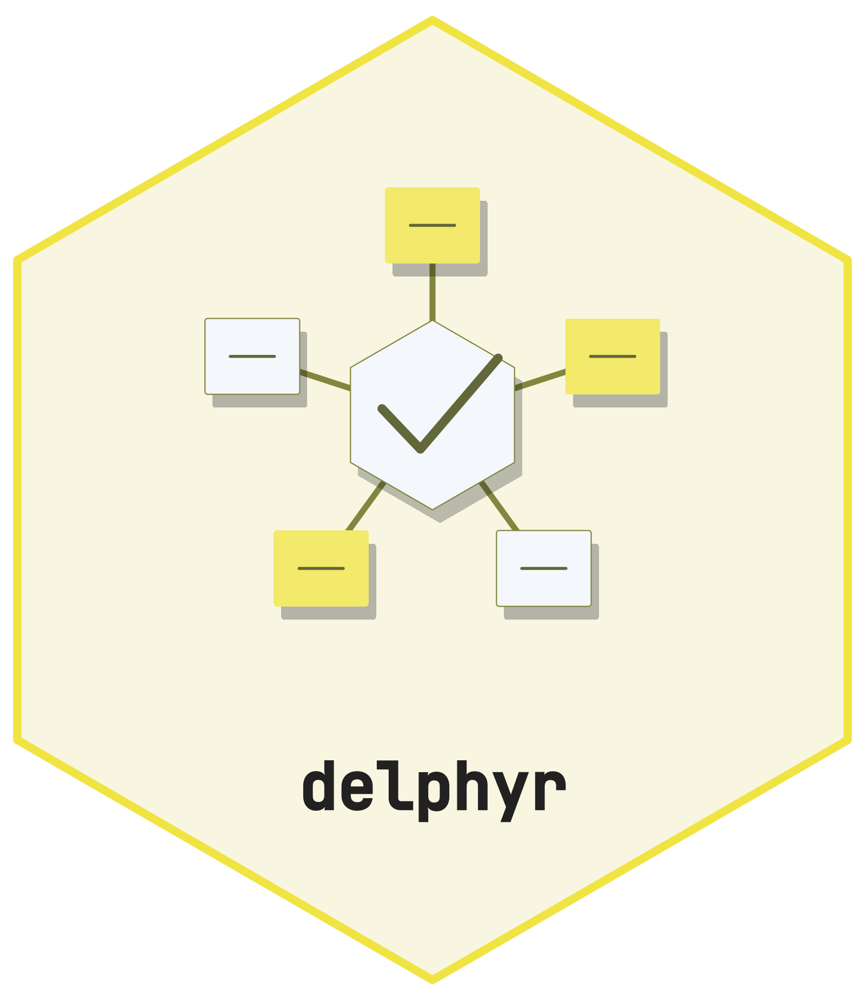

# delphyr <picture class="cttir-readme-logo"><source class="cttir-logo-dark-source" media="(prefers-color-scheme: dark)" srcset="man/figures/logo-with-name-dark.png" /></picture>

**Reproducible Delphi analysis, independent of the application.**

`delphyr` validates protocols and response scales, analyses frozen round data,
and provides the transactional services used by `delphyrApp`. Offline analysis
runs without Shiny or a database. Study services use PostgreSQL.

This is development software for synthetic studies. It is not a CRAN release,
a production qualification, or a validation of a study's scientific choices.

## Install and start

```r
# install.packages("remotes")
remotes::install_github("CTTIR/delphyR", subdir = "packages/delphyr",
                        build_vignettes = TRUE)

library(delphyr)
analysis <- analyse_round(demo_snapshot())
analysis$decisions
analysis$denominators
analysis$missingness
```

The synthetic snapshot explicitly uses pooled consensus. The complete demo
protocol instead requires adequate results in all designated groups. Example
thresholds are not recommendations. Missing responses are not zero ratings.

## Follow the worked example

```r
vignette("offline", package = "delphyr")
```

The [offline vignette](https://github.com/CTTIR/delphyR/blob/main/packages/delphyr/vignettes/offline.Rmd) executes two-round analysis,
contrasts group rules, reports missingness, checks comparability, and prepares
suppressed feedback. A feedback draft still needs a reviewed release before
participant use.

`reproduce_export(path)` verifies a previously obtained private round export
and recomputes its analysis without the application or Quarto;
`reproduce_study_export(path)` does the same for every round of a study-level
research export and for the comparisons between rounds. Exports do not include
qualitative originals or account mappings; they are not automatically suitable
for public release.

## Study services

The [repository guide](https://github.com/CTTIR/delphyR/blob/main/README.md) covers the local PostgreSQL environment,
worker, application, and verification commands. Services recheck identity,
study membership, capability, and state. Save receipts follow database commits;
submitted revisions and released scientific records remain traceable.

Panel imports create unbound drafts. Synthetic invitation acceptance requires
explicit approval of an existing issuer/subject identity. Campaigns produce only
local sink receipts. These boundaries do not qualify real recruitment,
external messages, or production identity infrastructure.

See [implementation status](https://github.com/CTTIR/delphyR/blob/main/docs/IMPLEMENTATION_STATUS.md) for executed
checks and remaining acceptance gates. Licensed under the [MIT License](https://github.com/CTTIR/delphyR/blob/main/LICENSE).

## Use of LLM tools

Where applicable, LLM tools were used for narrowly defined, non-authorial tasks:
copyediting, prose refinement, Markdown/LaTeX formatting, boilerplate scaffolding
(such as CI configurations and build scripts), and code refactoring. Tools included
[Chat AI](https://kisski.gwdg.de/leistungen/2-02-llm-service/), the KISSKI
(GWDG) service, and self-hosted **Mistral Small (24B, Apache-2.0)** served through
a local **vLLM architecture** on an Ubuntu Linux workstation with Intel
processors and NVIDIA GPUs. The self-hosted model ran locally, with no data sent
to third parties.

All scientific claims, methodological choices, analyses, interpretations and
conclusions remain the authors' own. Where applicable, LLM-generated material
must be reviewed and revised before inclusion, and references must be verified
against their DOI, arXiv ID or ISBN.

Local software setup: vLLM with Python/PyTorch, plus R and RStudio.
